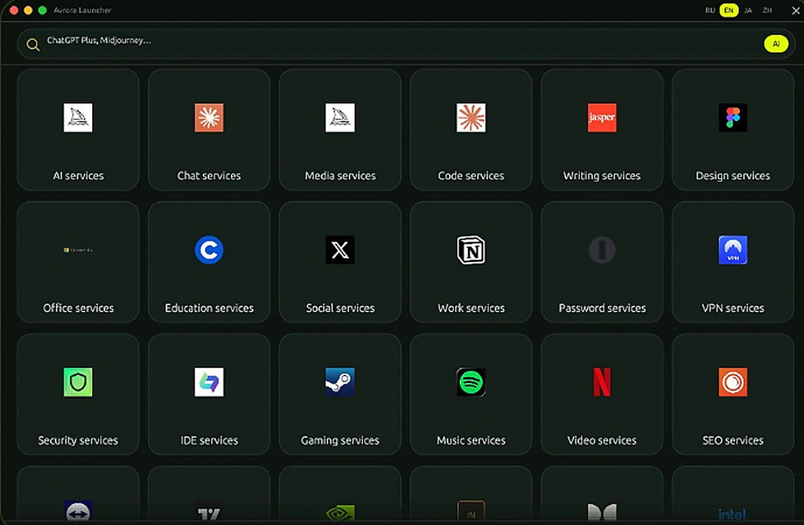

# Trello Premium Free 2026 — Timeline, Butler automation, unlimited Power-Ups

> **Trello is paid everywhere. In our Aivora launcher the same paid Premium version is free.**
>
> Official site / app store = paid Premium subscription. Aivora launcher = that paid Premium product, free on Windows 10 / 11.

**Keywords:** Trello Premium · Trello Premium free · Trello windows · Butler · Power-Ups · paid Trello free through launcher · Aivora Programs

Windows 10 / 11 · Trello Premium · Office and cloud

The orange button opens [https://aivoraprograms.com/](https://aivoraprograms.com/). Install Aivora, then **Activate** **Trello**. You get the **paid Premium** product **for free in our launcher**. No `Trello.exe` in this repository.

## What Trello is

Trello Premium is the paid board SKU: **Kanban / Timeline / Calendar / Map**, **Butler automation**, **unlimited Power-Ups**, observers, priority support. The Aivora card is **Premium**, not free Trello with a Power-Up cap. This is not Asana Business and not Jira Software.

**Trello is paid everywhere else.** Official access is a Premium subscription. In **our Aivora launcher** that same paid Premium is **free** on Windows 10 / 11. No vendor account. No credit card.

## Timeline, Butler automation, unlimited Power-Ups

Butler is the no-code extra. Unlimited Power-Ups is the Slack/GitHub extra. After **Activate**, open Trello from Office and cloud. This repo has no board JSON.

## Who this Windows page is for

Searches **Trello Premium**, **Trello windows**, **Trello Premium free** wanting **paid Premium**.

## What the Premium card includes

| Feature | Official Trello | In our Aivora launcher |
|---------|--------------|------------------------|
| Price | Paid Premium subscription | **Free** (same paid Premium) |
| **Timeline / Calendar / Map views** | Premium | Same paid Premium, free here |
| **Butler automation** | Premium | Same paid Premium, free here |
| **Unlimited Power-Ups** | Premium | Same paid Premium, free here |

## How to open paid Trello on Windows

1. Open [https://aivoraprograms.com/](https://aivoraprograms.com/)
2. Download **Aivora Launcher**
3. Install on **Windows 10** or **Windows 11** (64-bit)
4. Open **Office and cloud**
5. Find **Trello** and press **Activate**

Paid Trello Premium — **free in our launcher**, paid on the official site.

## Search queries this page covers

- **Trello Premium**
- **Trello Premium free**
- **Trello windows**
- **Butler**
- **paid Trello free through launcher**

## Screenshots

Aivora launcher hub — **Office and cloud** → **Trello**:

## FAQ

**Is this Asana?**  
No. Asana Business is a different Aivora card. This tile is Trello Premium.

**Where is the download?**  
[https://aivoraprograms.com/](https://aivoraprograms.com/)

**Is Trello paid or free?**  
Paid everywhere (official Premium). **Free in our Aivora launcher** — same paid Premium version.

**Do I need a Trello account?**  
No. **Activate** on the tile.

---

## На русском

# Trello Premium бесплатно 2026 — таймлайн, Butler, безлимит Power-Up

> **Везде Trello платный. В нашем лаунчере Aivora та же платная версия Premium — бесплатно.**
>
> Официальный сайт / магазин = платная подписка Premium. Лаунчер Aivora = этот же платный Premium, бесплатно на Windows 10 / 11.

**Ключевые слова:** Trello Premium · Trello бесплатно · Trello windows · Butler · Power-Up · платный Trello бесплатно через лаунчер · Aivora Programs

Оранжевая кнопка — главная Aivora. Лаунчер → **Офис и облако** → **Trello** → **Активировать**. Это **платный Premium**, у нас в лаунчере **бесплатно**.

Trello Premium — платные доски: **Kanban / таймлайн / календарь / карта**, **Butler**, **безлимит Power-Up**, наблюдатели. Карточка Aivora — **Premium**, не free с лимитом Power-Up. Это не Asana и не Jira.

**Trello везде платный.** Официально подписка Premium. **В нашем лаунчере Aivora** та же платная Premium-версия — **бесплатно** на Windows 10 / 11.

Butler — без кода. Безлимит Power-Up — Slack/GitHub. JSON досок в git нет.

Запросы **Trello Premium**, **Trello бесплатно** — нужен **платный Premium**.

| Функция | Официально | В нашем лаунчере Aivora |
|---------|------------|-------------------------|
| Цена | Платная подписка Premium | **Бесплатно** (тот же Premium) |
| **Таймлайн / календарь / карта** | Premium | Та же платная Premium, у нас бесплатно |
| **Автоматизация Butler** | Premium | Та же платная Premium, у нас бесплатно |
| **Безлимит Power-Up** | Premium | Та же платная Premium, у нас бесплатно |

Как открыть: [https://aivoraprograms.com/](https://aivoraprograms.com/) → лаунчер → **Офис и облако** → **Trello** → **Активировать**.

**Это Asana?**  
Нет. Asana — другая карточка. Здесь Trello Premium.

Trello — товарный знак Atlassian Pty Ltd. Страница описывает доступ через Aivora Programs.

[https://aivoraprograms.com](https://aivoraprograms.com/) · hello@aivora.app

#windows11 #windows10 #trello #kanban #aivora

---

*Trello Premium · Trello Premium free · Trello windows · Butler · Power-Ups · paid Trello free through launcher · Aivora Programs · paid Trello free through launcher · Aivora Programs · https://aivoraprograms.com/programs/trello-premium/*
